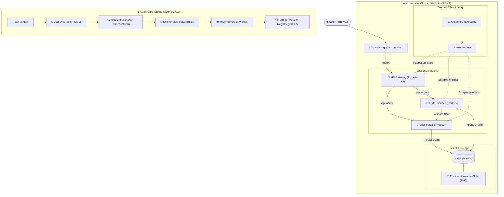

# 🚀 Cloud-Native DevOps Microservices Stack

[](https://github.com/rahulsinghkushwaha232/devops-microservices-stack/actions/workflows/ci-cd.yml)
[](https://nodejs.org/)
[](https://www.docker.com/)
[](https://kubernetes.io/)
[](https://www.mongodb.com/)
[](https://aquasecurity.github.io/trivy/)
[](https://prometheus.io/)
[](LICENSE)

An enterprise-ready, end-to-end **DevOps & Cloud-Native Microservices Architecture** demonstrating modern software delivery practices: containerization, orchestration, automated DevSecOps CI/CD, Infrastructure-as-Code (IaC), GitOps-ready Kubernetes manifests, and full-stack observability.

**Author:** [Rahul Singh Kushwaha](https://github.com/rahulsinghkushwaha232)

---

## 📑 Table of Contents

- [System Architecture](#-system-architecture)
- [Key Features](#-key-features)
- [Technology Stack](#-technology-stack)
- [Project Directory Structure](#-project-directory-structure)
- [Local Development & Quick Start](#-local-development--quick-start)
  - [Prerequisites](#prerequisites)
  - [Option A: Local Kubernetes (`kind`) - Recommended](#option-a-local-kubernetes-kind---recommended)
  - [Option B: Docker Compose](#option-b-docker-compose)
  - [Running Unit & Integration Tests](#running-unit--integration-tests)
- [DevSecOps CI/CD Pipeline](#-devsecops-cicd-pipeline)
- [Observability & Monitoring](#-observability--monitoring)
- [Infrastructure as Code (Terraform)](#-infrastructure-as-code-terraform)
- [API Reference](#-api-reference)
- [Deployment Targets](#-deployment-targets)
- [Security Best Practices](#-security-best-practices)
- [License](#-license)

---

## 🏛️ System Architecture



---

## ✨ Key Features

- **Decoupled Microservices Architecture:** Gateway pattern with dedicated `user-service` and `order-service`, communicating over internal REST contracts with built-in retries and timeouts.
- **Production-Grade Kubernetes:**
  - Declarative manifests using **Kustomize**.
  - **Horizontal Pod Autoscaling (HPA)** for dynamic scaling under load.
  - **Zero-Trust NetworkPolicies** restricting inter-pod network isolation.
  - Robust **Liveness & Readiness Probes** preventing traffic to unready pods.
  - Stateful persistence using **PersistentVolumeClaims (PVC)** for MongoDB.
- **Automated DevSecOps Pipeline:**
  - Fast matrix unit tests across all microservices.
  - Strict Kubernetes manifest linting via `kubeconform`.
  - Automated vulnerability gate using **Aquasec Trivy** (blocking fixable CRITICAL vulnerabilities).
  - Versioned and tagged image publishing to **GitHub Container Registry (GHCR)**.
- **Deep Observability:**
  - Native Prometheus instrumentation with HTTP request counts and latency histograms.
  - Pre-configured Grafana dashboard JSON and Kubernetes Alert rules.
- **Infrastructure as Code (IaC):**
  - Modular **Terraform** configuration provisioning an AWS VPC with public/private subnets, NAT Gateways, and managed **AWS EKS** clusters.

---

## 🛠️ Technology Stack

| Domain | Technology | Purpose |
| :--- | :--- | :--- |
| **Runtime & Gateway** | Node.js 20, Express | API Gateway & Microservices runtime |
| **Database** | MongoDB 7.0, Mongoose | Document datastore for Users & Orders |
| **Containerization** | Docker, Docker Compose | Multi-stage, minimal distroless-ready images |
| **Orchestration** | Kubernetes, kind | Container deployment, services, ingress, HPA |
| **Ingress** | NGINX Ingress Controller | Layer 7 HTTP path routing |
| **CI/CD** | GitHub Actions | Automated test, lint, scan, and GHCR delivery |
| **Security Scanning** | Trivy | Container image vulnerability inspection |
| **Observability** | Prometheus & Grafana | Metrics harvesting, alerting, visual dashboards |
| **IaC** | Terraform (AWS Provider) | Cloud infrastructure provisioning (VPC & EKS) |

---

## 📂 Project Directory Structure

```text
devops-microservices-stack/
├── .github/
│   └── workflows/
│       ├── ci-cd.yml             # Automated CI/CD pipeline (Test, Lint, Trivy Scan, Publish)
│       └── deploy.yml            # Manual EKS CD deployment workflow
├── app/                          # API Gateway & Web UI
│   ├── public/                   # Static Frontend Assets (HTML, CSS, JS)
│   ├── tests/                    # Gateway unit & proxy tests
│   ├── Dockerfile                # Multi-stage production container
│   ├── index.js                  # Express Gateway & Prometheus metrics
│   └── package.json
├── services/
│   ├── user-service/             # User Management Service (CRUD + MongoDB)
│   │   ├── tests/                # User service test suite
│   │   ├── Dockerfile
│   │   └── index.js
│   └── order-service/            # Order Management Service (CRUD + User validation)
│       ├── tests/                # Order service test suite
│       ├── Dockerfile
│       └── index.js
├── k8s/                          # Production Kubernetes Manifests
│   ├── scripts/
│   │   ├── local-up.ps1          # One-click kind cluster bootstrapper
│   │   └── local-down.ps1        # Cluster teardown script
│   ├── app-deployment.yaml       # Gateway Deployment & Service
│   ├── user-deployment.yaml      # User Service Deployment & Service
│   ├── order-deployment.yaml     # Order Service Deployment & Service
│   ├── mongo-deployment.yaml     # MongoDB Deployment & PVC
│   ├── ingress.yaml              # NGINX Ingress definitions
│   ├── hpa.yaml                  # Horizontal Pod Autoscaling policies
│   ├── networkpolicy.yaml        # Inter-service network security policies
│   └── kustomization.yaml        # Kustomize root overlay
├── monitoring/                   # Observability Stack
│   ├── scripts/                  # Prometheus & Grafana deploy scripts
│   ├── grafana-dashboard.yaml    # Pre-built monitoring dashboard
│   ├── prometheus-rules.yaml     # Latency & error rate alert rules
│   └── values-kube-prometheus-stack.yaml
├── terraform/                    # AWS Cloud Infrastructure (IaC)
│   ├── main.tf                   # VPC, EKS cluster, and Node Group definitions
│   ├── variables.tf              # Configurable region, CIDR, node counts
│   └── outputs.tf
├── docker-compose.yml            # Local containerized development
├── vercel.json                   # Vercel configuration for Web UI
└── README.md
```

---

## ⚡ Local Development & Quick Start

### Prerequisites
- [Node.js 20+](https://nodejs.org/) & `npm`
- [Docker Desktop](https://www.docker.com/products/docker-desktop/)
- For Local K8s: `kind`, `kubectl`, and `helm`

---

### Option A: Local Kubernetes (`kind`) - *Recommended*

Run the full Kubernetes production topology locally on your machine with one command:

```powershell
# 1. Start Kind cluster, build images, and apply all manifests
.\k8s\scripts\local-up.ps1

# 2. Check pod and service status
kubectl get pods,svc,ingress,hpa -n devops-demo
```

Once all pods show `Running`, open **[http://localhost](http://localhost)** in your browser!

To cleanly destroy the local cluster:
```powershell
.\k8s\scripts\local-down.ps1
```

---

### Option B: Docker Compose

If you don't need Kubernetes locally, run the multi-container stack via Docker Compose:

```powershell
# 1. Copy environment variables
Copy-Item .env.example .env

# 2. Build and launch all services
docker compose up --build -d

# 3. View status
docker compose ps
```
Access the application at **[http://localhost:3000](http://localhost:3000)**.

To stop the containers:
```powershell
docker compose down -v
```

---

### Running Unit & Integration Tests

All microservices have isolated Jest test suites with 100% mocked database and network layers:

```powershell
# Gateway tests (7 tests)
cd app; npm test; cd ..

# User Service tests (9 tests)
cd services/user-service; npm test; cd ../..

# Order Service tests (14 tests)
cd services/order-service; npm test; cd ../..
```
> **Result:** All 30 unit & integration tests pass with 0 errors.

---

## 🛡️ DevSecOps CI/CD Pipeline

The automated GitHub Actions workflow (`.github/workflows/ci-cd.yml`) triggers on every pull request and push to `main`:

1. **Parallel Unit Testing:** Runs `npm test` across all three Node.js components concurrently.
2. **K8s Manifest Linting:** Uses `kubeconform` to strictly validate all Kubernetes manifests against official Kubernetes OpenAPI schemas.
3. **Container Build & Trivy Scan:** Builds multi-stage Docker images and executes **Aquasec Trivy** scans. Any fixable **CRITICAL** vulnerability will automatically block the pipeline.
4. **Publish to GHCR:** On push to `main`, sanitized images are pushed to GitHub Container Registry:
   - `ghcr.io/rahulsinghkushwaha232/devops-app:latest`
   - `ghcr.io/rahulsinghkushwaha232/devops-user-service:latest`
   - `ghcr.io/rahulsinghkushwaha232/devops-order-service:latest`

---

## 📊 Observability & Monitoring

Deploy the Prometheus & Grafana stack inside the local cluster:

```powershell
# Deploy kube-prometheus-stack and ServiceMonitors
.\monitoring\scripts\monitoring-up.ps1

# Port-forward Grafana
kubectl port-forward -n monitoring svc/kube-prometheus-stack-grafana 3000:80
```
- Open **[http://localhost:3000](http://localhost:3000)** (Default username: `admin`).
- Retrieve the auto-generated password:
  ```powershell
  $encoded = kubectl get secret kube-prometheus-stack-grafana -n monitoring -o "jsonpath={.data.admin-password}"
  [Text.Encoding]::UTF8.GetString([Convert]::FromBase64String($encoded))
  ```

---

## ☁️ Infrastructure as Code (Terraform)

Deploy an enterprise VPC and AWS EKS cluster with managed node groups:

```powershell
cd terraform
Copy-Item terraform.tfvars.example terraform.tfvars

terraform init
terraform plan
terraform apply
```
*(Review AWS resource costs before applying).*

---

## 📡 API Reference

### Gateway & Health Endpoints
| Method | Endpoint | Description |
| :--- | :--- | :--- |
| `GET` | `/health` | Gateway health check status |
| `GET` | `/metrics` | Prometheus metrics scrape target |

### User Service (`/api/users`)
| Method | Endpoint | Description | Request Body |
| :--- | :--- | :--- | :--- |
| `GET` | `/api/users` | List all users | None |
| `POST` | `/api/users` | Create a new user | `{"name":"Rahul","email":"rahul@test.com","role":"admin"}` |
| `GET` | `/api/users/:id` | Get user details | None |
| `DELETE`| `/api/users/:id` | Remove user | None |

### Order Service (`/api/orders`)
| Method | Endpoint | Description | Request Body |
| :--- | :--- | :--- | :--- |
| `GET` | `/api/orders` | List all orders | None |
| `POST` | `/api/orders` | Create order (validates user existence) | `{"userId":"<USER_ID>","item":"Cloud License","quantity":1,"price":99.00}` |
| `GET` | `/api/orders/:id`| Get order details | None |
| `DELETE`| `/api/orders/:id`| Remove order | None |

---

## 🌐 Deployment Targets

### 1. Local Kubernetes Cluster
Already configured and verified running via `kind` at `http://localhost`.

### 2. Cloud Kubernetes (AWS EKS)
Automated continuous deployment via `.github/workflows/deploy.yml` using AWS GitHub OIDC federation.

### 3. Vercel (Web UI / Frontend)
The frontend UI is configured with `vercel.json` for one-click deployment:
1. Log in to [Vercel](https://vercel.com).
2. Click **Add New Project** -> **Import** from GitHub (`devops-microservices-stack`).
3. Vercel automatically deploys the UI from `app/public`.

---

## 🔒 Security Best Practices

- **Least Privilege:** Containers execute as non-root users (`uid 10001`) with dropped Linux capabilities.
- **Secret Management:** Secrets are separated into Kubernetes Secrets and ignored `.env` files.
- **Network Isolation:** Kubernetes `NetworkPolicy` denies unauthorized inter-pod egress and ingress.
- **OIDC Authentication:** GitHub Actions assumes AWS IAM roles via short-lived OIDC tokens rather than static AWS credentials.

---

## 📜 License

This project is licensed under the [MIT License](LICENSE).
